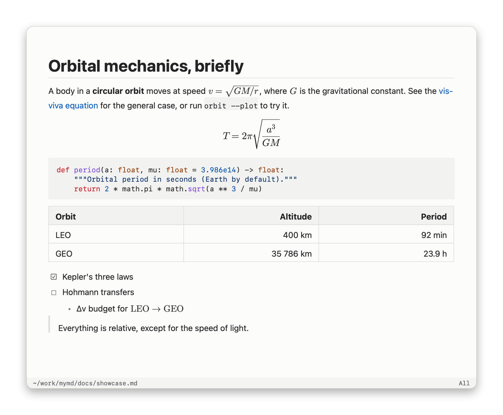

# mymd

A minimal, native macOS markdown viewer in the spirit of zathura: no toolbar, no
title bar, no web view. Plain AppKit + TextKit, ~2k lines of Swift, one vendored
library (SwiftMath, for TeX).

<picture>
  <source media="(prefers-color-scheme: dark)" srcset="docs/screenshots/dark.png">
  
</picture>

## Build

    make            # -> build/mymd.app
    make install    # app -> /Applications, `mymd` command -> ~/.local/bin
                    # (override with PREFIX=... BINDIR=...)
    make screenshots  # regenerate docs/screenshots from docs/showcase.md

Then from a terminal:

    mymd README.md            # opens in the running instance if there is one
    mymd docs/*.md            # one window per file

Finder's "Open With" and `open -a mymd file.md` work too.

## Keys

| key                         | action                         |
|-----------------------------|--------------------------------|
| `j` `k` / arrows            | scroll                         |
| `d` `u` / `C-d` `C-u`       | half page                      |
| `space` `S-space` / `J` `K` / `C-f` `C-b` | full page        |
| `gg` `G`                    | top / bottom                   |
| `/` `?` then `n` `N`        | search (smart case, incremental) |
| `f` + number                | follow link by hint            |
| `C-o` / `backspace`         | jump back (links, anchors)     |
| `+` `-` `0`                 | zoom in / out / reset          |
| `i` / `C-r`                 | toggle dark / light            |
| `C-n`                       | toggle status bar              |
| `r`                         | reload (also auto-reloads on save) |
| `o`                         | open file                      |
| `q`                         | close window                   |

Mouse selection + `⌘C` copies text. Clicking links works too.

## Supports

CommonMark + GFM: headings, emphasis, strikethrough, inline/fenced code, block
quotes (nested), ordered/unordered/nested lists, task lists, tables with column
alignment, thematic breaks, links (web, relative `.md` files, `#heading` anchors),
local and remote images (incl. SVG), footnotes, YAML front matter, and the common
README HTML subset (``, `<p align=center>`, `<br>`, `<b>`, `<a>`, `<sup>`, `<details>`…).

**Code**: fenced blocks are syntax-highlighted for ~40 languages (C family,
Swift, Rust, Go, Python, JS/TS, shell, SQL, YAML, …) plus `diff` and HTML/XML.

**Math**: `$inline$`, `\(inline\)`, `$$display$$`, `\[display\]` and ```` ```math ````
blocks, typeset natively with [SwiftMath](https://github.com/mgriebling/SwiftMath)
(vendored in `Vendor/`, Latin Modern font). Dollar amounts like `$5` stay text;
invalid TeX is shown as red source.

Not supported: mermaid.
