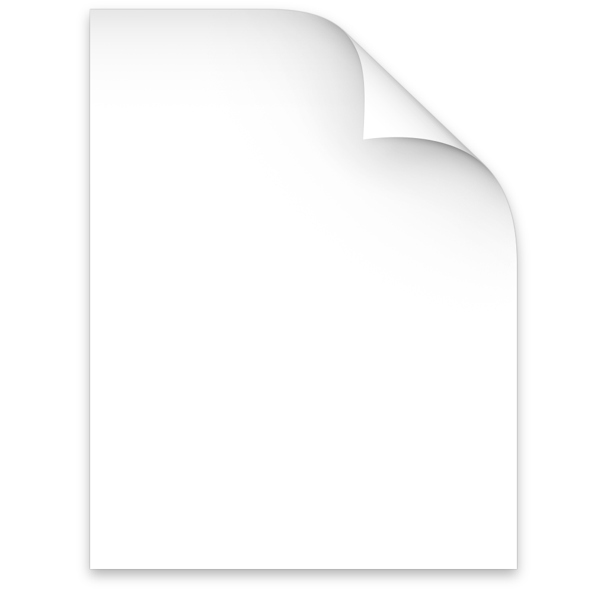

# mymd sample

A paragraph with **bold**, *italic*, ***both***, `inline code`, ~~strike~~, and a [link](https://example.com).
Soft wrapped line continues here. Footnote ref[^1].  
Hard break above.

## Contents

- [Lists](#lists)
- [Code](#code)
- [Tables](#tables)

## Lists

- First item
- Second item with a longer line that should wrap nicely onto the next line with a proper hanging indent under the text
  - Nested item
    - Deeper item
- [ ] Todo item
- [x] Done item

1. One
2. Two
   1. Two point one
10. Ten

> A blockquote with *emphasis*.
>
> > Nested quote.

## Code

```swift
func hello(_ name: String) -> String {
    return "Hello, \(name)!"
}
```

## Tables

| Name | Align center | Right |
|------|:------------:|------:|
| a    | b            | 1.00  |
| longer cell | | 22.50 |

---

### Images



<p align="center">
   <br>
  <b>Centered HTML</b> with <a href="#mymd-sample">anchor link</a>
</p>

#### Heading 4
##### Heading 5
###### Heading 6

[^1]: This is the footnote text.
